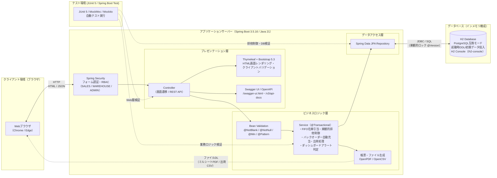

レイヤー / 要素 | 採用技術 | 採用理由・設計上の工夫
---|---|---
プレゼンテーション層 | Spring MVC / Thymeleaf / Bootstrap 5.3 / Springdoc | 画面操作はSSRとPRGパターン、外部連携は `/api/v1` のREST APIとOpenAPIで提供。
セキュリティ層 | Spring Security 6 | ログイン画面およびロール別アクセス制御を実装。ログイン・Swagger・H2 ConsoleはpermitAll。画面更新は営業・倉庫・管理者ロールで制御。
入力検証 | HTML `required` / `setCustomValidity` / Bean Validation | クライアント側で項目別日本語メッセージを表示し、サーバー側でも空白文字、必須項目、重量値を検証。
ビジネスロジック層 | Spring Service / OpenPDF / OpenCSV | 在庫引当、入荷時バックオーダー充当、出荷確定を `@Transactional`で保護。楽観ロック競合時は処理を中断。
データアクセス層 | Spring Data JPA / Hibernate 6 | コイルエンティティに `@Version` を付与し、同時更新時の競合を検知。
データベース | H2 Database（MODE=PostgreSQL） | 開発・デモ確認用のインメモリ構成。起動時にスキーマとサンプルデータを投入。
テスト基盤 | JUnit 5 / Spring Boot Test / MockMvc / Mockito | FIFO在庫引当・バックオーダー充当のロジック検証、`@Version` による楽観ロック競合テスト、REST APIのバリデーションおよびRBAC権限テストを自動化。

外部連携REST API：`/api/v1/inventories`（在庫取得）、`/api/v1/orders`（注文一覧・登録）、`/api/v1/arrivals`（入荷登録）のGET/POSTエンドポイントを提供する。`/api/v1/inventories` は `@Valid @ModelAttribute` によるクエリパラメータ検証（`@DecimalMin`、`@Positive`）を行い、`/api/v1/orders` と `/api/v1/arrivals` は `@RequestBody @Valid` により `@NotBlank`、`@NotNull`、`@Min`、`@Pattern` をサーバー側で検証する。Swagger画面自体はpermitAllだが、保護対象APIへの呼び出しには認証とCSRF方針が適用される。

