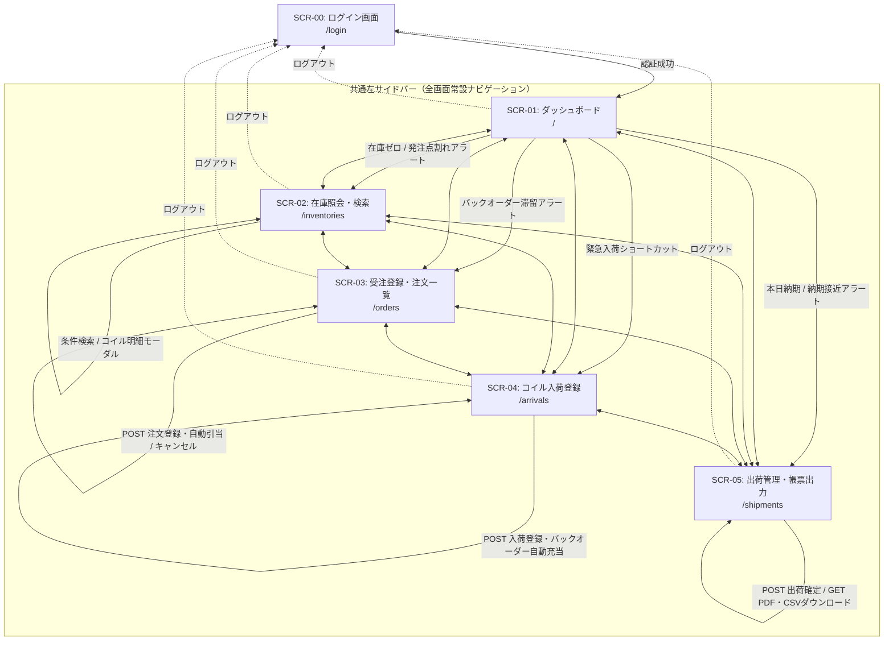

画面設計書（画面遷移図・画面機能一覧）

1. 画面一覧・権限マトリクス

本システムは、業務役割に応じたロールベースアクセス制御（Spring Security）を採用し、全6画面で構成される。

| 画面ID | 画面名 | URLパス | 営業担当（SALES） | 倉庫担当（WAREHOUSE） | 主な役割 |
|---|---|---|:---:|:---:|---|
| SCR-00 | ログイン画面 | /login | ○ | ○ | 認証・ロール切替（デモ用ワンクリック入力補助付き） |
| SCR-01 | ダッシュボード | / | ○ | ○ | KPIサマリー表示、緊急度別アラート（赤・黄・青）によるタスク誘導 |
| SCR-02 | 在庫照会・検索 | /inventories | ○ | ○ | 鋼種・サイズ複合検索、鋼板別有効在庫サマリー、個別コイル明細確認 |
| SCR-03 | 受注登録・注文一覧 | /orders | ○ | 閲覧のみ | 新規注文登録（自動引当実行）、注文一覧、引当明細確認、注文キャンセル |
| SCR-04 | コイル入荷登録 | /arrivals | 閲覧のみ | ○ | 新規コイル入荷登録、バックオーダー自動充当の実行、直近入荷履歴確認 |
| SCR-05 | 出荷管理・帳票出力 | /shipments | 閲覧のみ | ○ | 出荷確定処理（実在庫払出）、ミルシート（PDF）出力、出荷実績（CSV）出力 |

※管理者ロール（ROLE_ADMIN）は全画面の閲覧およびすべての更新操作が可能。

2. 画面遷移図（Mermaid記法）

3. 各画面の機能・表示項目詳細

### SCR-00：ログイン画面（/login）

- **表示項目**：ログインID入力欄、パスワード入力欄、固定高さのエラー表示領域、デモ用ログイン補助ボタン（「営業担当で入力」「倉庫担当で入力」「管理者で入力」）。
- **バリデーション**：ログインID・パスワードはブラウザ送信前に空白のみを拒否し、「ログインIDを入力してください」「パスワードを入力してください」を項目別に表示する。正しく入力またはデモボタンで入力すると表示を消去する。認証失敗時は「IDまたはパスワードが正しくありません」を表示する。
- **処理概要**：Spring Security による認証を実行し、成功時はダッシュボード（/）へリダイレクトする。

### SCR-01：ダッシュボード（/）

- **表示項目**：
  - KPIサマリーカード：本日の受注件数、引当待ち（バックオーダー）件数、出荷待ち件数。
  - 要対応アラート一覧（緊急度別色分け）：
    - 赤（緊急 alert-danger）：有効在庫0kgの鋼板、本日納期の未出荷注文、バックオーダー発生中の注文。
    - 黄（警告 alert-warning）：安全在庫（発注点）割れの鋼板、納期まで3日以内の未出荷注文。
    - 青（注意 alert-info）：入荷から90日以上経過した長期滞留コイル。
- **処理概要**：各カードおよびアラート行のアクションボタンから、該当条件で絞り込んだ各業務画面へ遷移する。

### SCR-02：在庫照会・検索画面（/inventories）

- **表示項目**：
  - 検索条件フォーム：鋼種（SPCC / SGCC / JAC270C / SECC）、用途区分、板厚（最小〜最大）、板幅（最小〜最大）。
  - 鋼板別在庫一覧（親テーブル）：鋼板コード、鋼板名、用途区分、サイズ（板厚×板幅）、総在庫重量、引当済重量、有効在庫重量、安全在庫重量、在庫状況バッジ（適正 / 要発注 / 在庫切れ）。
  - コイル明細モーダル（子テーブル）：コイル番号、入荷日、初期重量、引当済重量、有効残重量、コイルステータス（在庫あり / 一部引当済 / 全量引当済）。
- **処理概要**：複合条件で鋼板マスタとコイル在庫を集計検索する。行の「コイル明細」ボタン押下で、該当鋼板に紐づく個別コイルの内訳をモーダル表示する。

### SCR-03：受注登録・注文一覧画面（/orders）

- **表示項目**：
  - 処理結果通知バナー：直前の注文登録（引当済／引当待ち）またはキャンセル結果を表示。
  - 新規注文登録フォーム：取引先名、鋼板選択プルダウン（現在の有効在庫重量を併記）、注文重量（kg）、希望納期。
  - 注文一覧テーブル：注文番号、受注日時、取引先名、鋼板名・サイズ、注文重量、引当済重量、希望納期、ステータスバッジ（引当済 / 引当待ち / 出荷済 / キャンセル）。
  - 引当明細モーダル：対象注文に引き当てられたコイル番号と各引当重量の内訳一覧。
- **バリデーション**：取引先名、鋼板、注文重量、希望納期は必須とする。取引先名の空白文字のみはブラウザ・サーバー双方で拒否し、エラー表示領域を固定して項目間の高さずれを防ぐ。正しく入力すると当該項目のエラーを消去する。サーバー側では `@NotBlank`、`@NotNull`、`@Min(1)`、`@Pattern`を使用する。
- **処理概要**：
  - 注文登録：トランザクション内で有効在庫からFIFO（入荷日昇順）で自動引当を実行。在庫不足時は BACKORDERED として登録し、PRGパターンで自画面へリダイレクトする。
  - 注文キャンセル：ALLOCATED または BACKORDERED の注文を CANCELED に変更し、引当済みコイルの有効残重量を復元する。

### SCR-04：コイル入荷登録画面（/arrivals）

- **表示項目**：
  - 自動引当結果通知バナー：入荷完了メッセージ、およびバックオーダーへの自動充当が発動した場合は対象注文番号・充当重量を強調表示。
  - 新規コイル入荷登録フォーム：鋼板選択プルダウン（現在の引当待ち件数・不足重量を併記）、コイル番号（自動採番初期値付き）、入荷重量（kg）、入荷日。
  - 直近入荷履歴テーブル：入荷日時、鋼板コード、コイル番号、鋼板名・サイズ、入荷重量、現在の有効残重量、自動充当実績メモ。
- **バリデーション**：鋼板、コイル番号、入荷重量、入荷日は必須とする。コイル番号は空文字または空白文字のみをブラウザ・サーバー双方で拒否する。入荷重量は1kg以上、各エラー領域は固定高さとし、正しく入力するとエラー表示を消去する。サーバー側では `@NotBlank`、`@NotNull`、`@Min(1)`、`@Pattern`を使用する。
- **処理概要**：新規コイルを coils テーブルに登録し、同一鋼板の BACKORDERED 注文が存在する場合は受注日時昇順（FIFO）で自動的に在庫を引き当ててステータスを ALLOCATED へ更新する。

### SCR-05：出荷管理・帳票出力画面（/shipments）

- **表示項目**：
  - 絞り込みタブ・一括出力ボタン：ステータスフィルタ（すべて / 出荷待ち（引当済） / 出荷済）、[出荷実績CSV出力] ボタン。
  - 出荷対象一覧テーブル：注文番号、希望納期、取引先名、鋼板名・サイズ、出荷重量、引当コイル番号（内訳重量付き）、ステータス、出荷確定日時、アクションボタン（[出荷確定] [ミルシートPDF]）。
- **処理概要**：
  - 出荷確定：ALLOCATED の注文を SHIPPED に更新し、紐づくコイルの物理残重量（physical_weight）および引当済重量を減算（払出）する。
  - 帳票出力：OpenPDF により対象注文のトレーサビリティ（使用コイル番号・重量・検査規格値）を記載したミルシートPDFを生成・ダウンロードする。また、OpenCSV により出荷済み一覧をBOM付きUTF-8のCSV形式で出力する。
